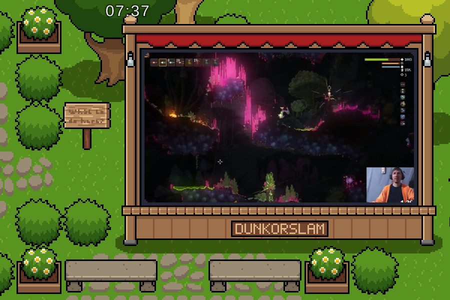
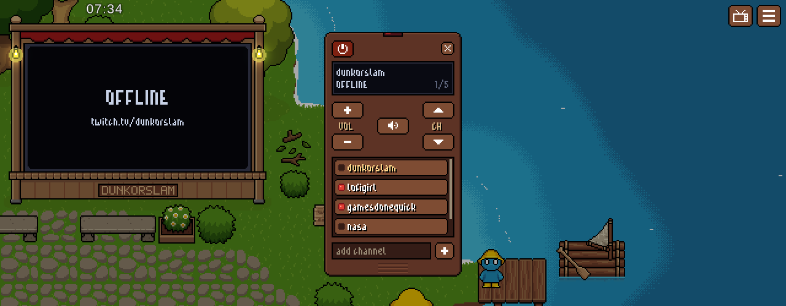

# Shorelands Billboard

A billboard at the town pond in Shorelands that plays a Twitch live stream, with sound that fades as you walk
away. By default it shows [twitch.tv/dunkorslam](https://www.twitch.tv/dunkorslam), the game developer's
channel.



The mod only changes your own game: nothing is sent to the game server, and other players see the billboard
only if they have the mod too. It is a fan-made mod, not made or supported by the game's developer, so please
don't report its problems to the game.

## Requirements

- **Shorelands on 64-bit Windows**, tested with Playtest 0.69i.
- **[BepInEx 5.4.23.6, x64](https://github.com/BepInEx/BepInEx/releases/tag/v5.4.23.6)**
  (`BepInEx_win_x64_5.4.23.6.zip`). Other BepInEx versions are untested.

The video decoder (libVLC) is included.

## Install

1. Close the game and open its folder (Steam: right-click the game, *Manage*, *Browse local files*).
2. If you don't have BepInEx yet, unzip it there so that `winhttp.dll` and `BepInEx\` sit next to
   `Shorelands.exe`. Start the game once and close it, so BepInEx creates its folders.
3. Download the zip from the [latest release](https://github.com/zerfl/ShorelandsBillboard/releases/latest)
   and unzip it into the same folder. You should now have
   `BepInEx\plugins\ShorelandsBillboard\ShorelandsBillboard.dll`.

To update, unzip a newer release over it. To uninstall, delete `BepInEx\plugins\ShorelandsBillboard` (and
`BepInEx\config\com.zerfl.shorelands.billboard.cfg` for the settings). No game files are changed.

## Using it

The billboard stands on the north side of the town pond, behind the two benches.

- The sound fades to silence about three billboard widths away (see `Range`). Beyond that the stream pauses
  (`STANDBY`) and resumes about a second after you return.
- The game's master volume applies to the billboard too.
- The base is solid; walk around its right end to get behind it.

## The remote



The television button left of the game's menu button (top right) opens the remote; it, `Esc` or the remote's
close button closes it. Drag it anywhere. It works from anywhere in the world.

| Control | Action |
| --- | --- |
| Power (red, top left) | Billboard on and off. |
| Display | Channel and status (see [Troubleshooting](#troubleshooting)), its place in the list, `MUTE`. |
| `VOL` + / - | Volume by a tenth. |
| Speaker | Mute. |
| `CH` up / down | Previous / next channel, wrapping around. |
| List row | Switch to that channel. Yellow: on now. Red dot: live. Mouse wheel scrolls. |
| Row's arrow / cross | Make it the default (top of the list) / remove it. |
| `add channel` + | Type a name or paste a channel address, then Enter or +. Up to 20 channels. |

The first channel in the list is the default and is what the billboard shows at every game start; switching
channels on the remote doesn't change it. While you type, keys go to the remote, not the game. The remote and
the settings file stay in sync both ways.

## Settings

The mod writes `BepInEx\config\com.zerfl.shorelands.billboard.cfg` on first start. Edits apply within a few
seconds, also while the game runs.

| Setting | Default | Meaning |
| --- | --- | --- |
| `[Billboard] Enabled` | `true` | `false` removes the billboard. |
| `[Billboard] Channels` | `dunkorslam` | Comma-separated channel names (`somechannel` from `twitch.tv/somechannel`). The first is the default. Invalid names and repeats are ignored. |
| `[Billboard] Channel` | `dunkorslam` | The channel on now; set it to switch immediately. Added to the list if missing. Reset to the first entry of `Channels` at every game start. |
| `[Billboard] Quality` | `auto` | `auto` picks just enough for the billboard's size on screen. `160`, `360`, `480`, `720`: at least that height. Higher rarely looks better and costs bandwidth and CPU. |
| `[Billboard] SharpPicture` | `true` | Draw the picture at screen resolution, so text in the stream is readable. `false`: the game's pixel-art resolution (184x104). |
| `[Sound] Volume` | `0.6` | `0` to `1`. |
| `[Sound] Mute` | `false` | Picture only. |
| `[Sound] Range` | `18` | `6` to `40`. Distance at which the sound reaches silence and the stream pauses (a hedge bush is 1). |
| `[Position] OffsetX`, `OffsetY` | `0` | `-40` to `40`. Move the billboard east/north (negative: west/south). Only hedge bushes are cleared under it, so pick a free spot. |
| `[Decoder] Backend` | `auto` | `auto`: the bundled libVLC, falling back to ffmpeg. `vlc` or `ffmpeg`: only that one. |
| `[Decoder] FfmpegPath` | empty | Path to `ffmpeg.exe`. Empty: search `PATH`, winget's install folders and the mod's folder. |
| `[Remote] Enabled` | `true` | `false` hides the remote and its button. |
| `[Remote] Key` | empty | Key that toggles the remote, e.g. `F8`. |

## Troubleshooting

| Screen | Meaning | What to do |
| --- | --- | --- |
| `CONNECTING` | Looking up the stream. | Wait a second or two. |
| `BUFFERING` | The stream stalled. | Wait; after 20 seconds the mod reconnects. |
| `OFFLINE` | The channel isn't live or doesn't exist. | Nothing; it checks every minute. |
| `AD BREAK` | Twitch is showing ads, which the mod skips. | Wait. |
| `NO SIGNAL` | Twitch unreachable or the stream unplayable. | Check your connection and firewall (`Shorelands.exe`). Retries from 5 seconds up to every minute. |
| `STANDBY` | You're out of range; the stream is paused. | Walk back. |
| `BAD CHANNEL` | `Channel` isn't a valid name. | Pick one on the remote or fix the file. |
| `NO DECODER` | libVLC files missing and no ffmpeg found. | Unzip the mod again. |
| `NO VLC` | `Backend = vlc` but libVLC files missing. | Unzip again or use `auto`. |
| `NO FFMPEG` | `Backend = ffmpeg` but no `ffmpeg.exe` found. | `winget install Gyan.FFmpeg`, set `FfmpegPath`, or use `auto`. |

For everything else, check the `ShorelandsBillboard` lines in `BepInEx\LogOutput.log`:

- **No such lines:** the mod didn't load. Check that BepInEx is installed (the log starts with
  `BepInEx 5.4.23.6`) and the mod is in `BepInEx\plugins`.
- **`the hedge north of the town pond is not where this version of the mod knows it`:** a game update moved
  the spot; the billboard stays off until a mod update.
- **`the billboard is switched off until the game restarts`** or **`no remote`:** something the mod relies on
  changed or failed; the preceding lines say what. If it happens every time, a mod update is needed.
- **Blocky picture:** the sharp picture couldn't be used; the log line mentioning `the sharp picture` says
  why.

## Privacy and network

While you're near the billboard, the mod fetches the stream like a logged-out browser on Twitch: from
`gql.twitch.tv` and `usher.ttvnw.net` to look it up, and from Twitch's video servers under `ttvnw.net`. It
sends the channel name plus what every web request carries (IP address, a generic browser identification), and
no account, cookies, device, player or PC information. While the remote is open, it also asks `gql.twitch.tv`
at most once a minute which channels in your list are live. No other server is contacted, including the game's.

Nothing is downloaded while you're out of range, in the main menu, or with `Enabled = false`.

## Known limitations

- Players without the mod don't see the billboard or its base, so they may walk through it.
- Name tags and speech bubbles draw over the picture.
- The stream is a few seconds behind live (no low-latency mode).
- The remote is mouse-only.
- Windows only.

## Licences

The mod's code and art are [MIT](LICENSE). The package also contains unmodified libVLC 3.0.24 and LibVLCSharp
3.10.2 from VideoLAN, under the [LGPL 2.1 or later](licenses/LGPL-2.1.txt), as separate replaceable files.
Source: [vlc-3.0.24.tar.xz](https://download.videolan.org/pub/videolan/vlc/3.0.24/vlc-3.0.24.tar.xz),
[LibVLCSharp 3.10.2](https://code.videolan.org/videolan/LibVLCSharp/-/tags/3.10.2). Versions and checksums are
in [THIRD-PARTY-NOTICES.txt](THIRD-PARTY-NOTICES.txt).

Shorelands belongs to its developer. Twitch is a trademark of Twitch Interactive, Inc.; this mod is not
affiliated with Twitch.

## Building from source

Requires 64-bit Windows, the [.NET SDK](https://dotnet.microsoft.com/download) 10+, and the game with BepInEx
installed: the build compiles against their assemblies. Pass the game folder as below, or set
`SHORELANDS_DIR` instead.

```
dotnet build src -c Release -p:GameDir="C:\Program Files (x86)\Steam\steamapps\common\Shorelands Playtest"
dotnet run --project tests -c Release -p:GameDir="..."
powershell -ExecutionPolicy Bypass -File tools\release.ps1 -GameDir "..."
```

These build `src\bin\Release\ShorelandsBillboard.dll`, run the tests (`ALL PASS` at the end; there is no CI
build, since it needs the game), and package `dist\ShorelandsBillboard-<version>.zip`. Packaging downloads the
pinned, checksum-verified libVLC packages from nuget.org.

The art in `art\` is generated by `make_billboard.py` and `make_remote.py` (Python, Pillow). Version history:
[CHANGELOG.md](CHANGELOG.md).
